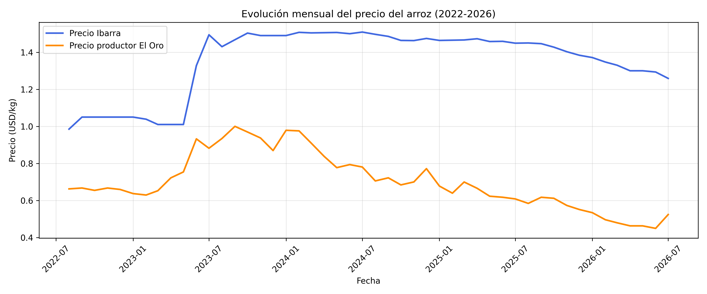
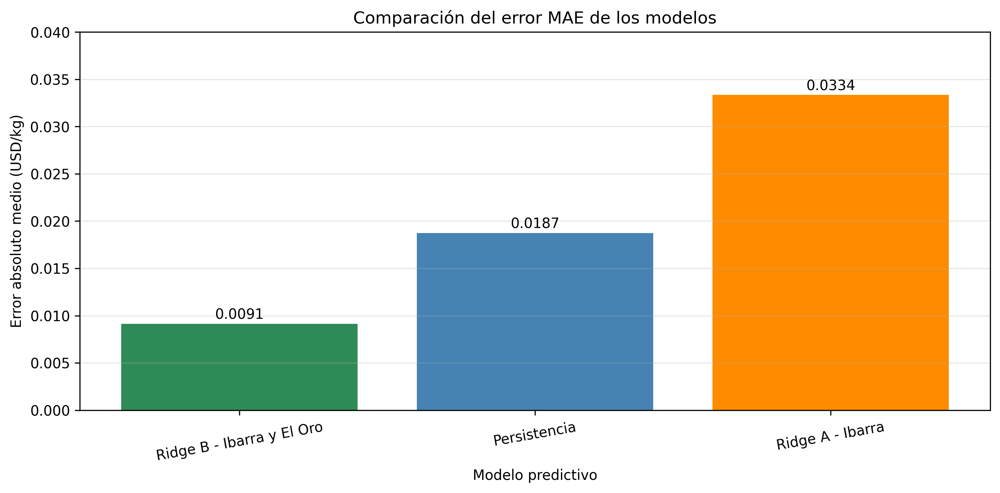
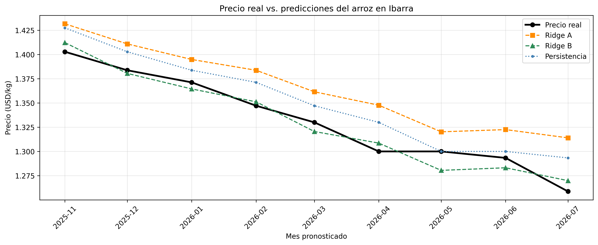
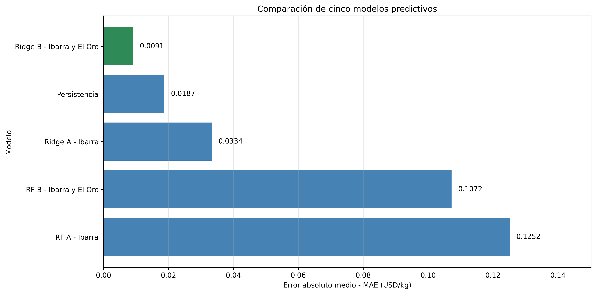
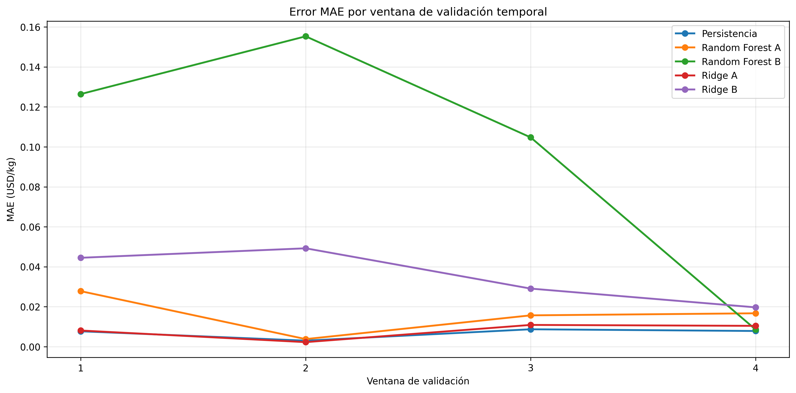
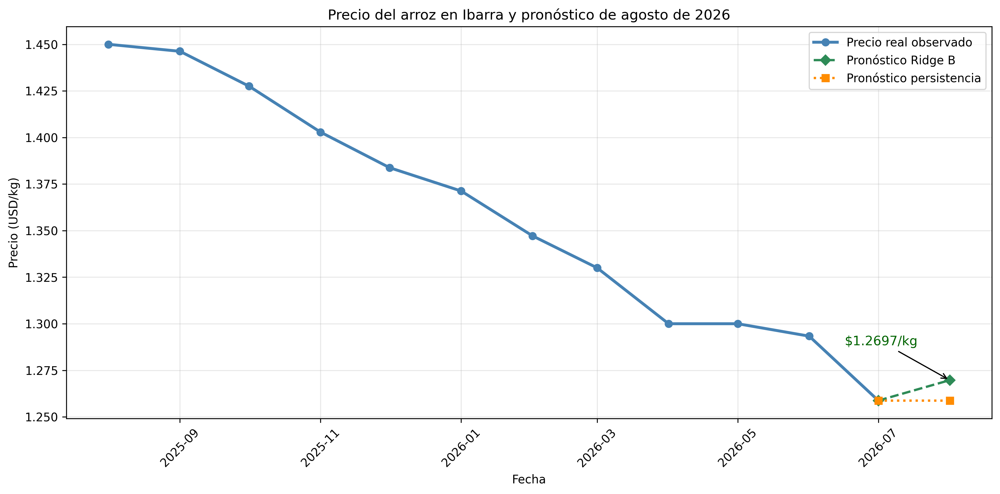
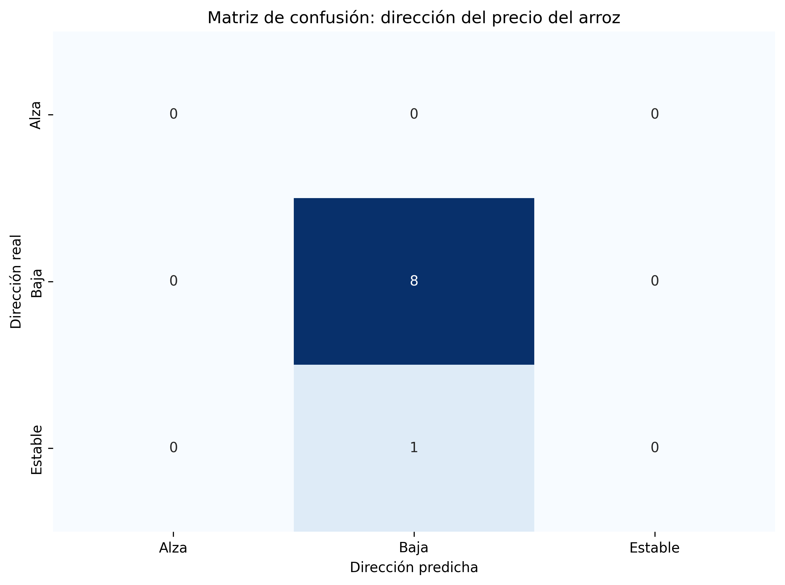

# Predicción de las fluctuaciones del precio del arroz en Ibarra mediante Machine Learning

**Universidad:** Yachay Tech  
**Programa:** Maestría en Ciencia de Datos  
**Período analizado:** Agosto de 2022 - Julio de 2026  
**Lenguaje:** Python  
**Herramientas:** Google Colab, Pandas, NumPy, Matplotlib, Seaborn y Scikit-learn.

## 1. Introducción

El precio del arroz constituye una variable económica relevante para productores, comerciantes y consumidores.

Esta investigación desarrolla modelos de aprendizaje automático para analizar y predecir las fluctuaciones mensuales del precio del arroz comercializado en Ibarra, Ecuador.

Se estudia si incorporar información histórica de los precios al productor en El Oro mejora la capacidad predictiva respecto de utilizar únicamente los precios de Ibarra.

## 2. Objetivo general

Desarrollar y comparar modelos de aprendizaje automático para predecir el precio mensual del arroz en Ibarra mediante información histórica de comercialización y precios al productor.

### Objetivos específicos

- Integrar las series de precios del arroz mediante fechas mensuales.
- Construir variables predictoras utilizando rezagos temporales.
- Entrenar modelos Ridge y Random Forest Regressor.
- Comparar el desempeño con un modelo de persistencia.
- Evaluar los resultados mediante MAE, RMSE y R².
- Aplicar validación temporal para estudiar la estabilidad predictiva.
- Generar una estimación retrospectiva del precio para agosto de 2026.
- Analizar la capacidad del modelo para identificar alzas y bajas.

## 3. Conjunto de datos

Se utilizan registros históricos de precios agrícolas procedentes del Sistema de Información Pública Agropecuaria (SIPA), previamente depurados en un proyecto de análisis exploratorio.

Las fuentes incluyen precios del arroz comercializado en bodegas de Ibarra y precios al productor de El Oro, Loja y Manabí.

El período estudiado comprende 48 meses consecutivos, desde agosto de 2022 hasta julio de 2026.

Para el modelado inicial se utilizaron las series completas de Ibarra y El Oro. Las observaciones de Loja y Manabí se conservaron en la base integrada, pero no se incorporaron al entrenamiento debido a su cobertura incompleta.

Durante la integración se identificaron dos precios para agosto de 2022 correspondientes al mismo producto, mercado y presentación. Se utilizó provisionalmente su promedio simple, de 0,985 USD/kg, como criterio de consolidación mensual.

## 4. Evolución histórica del precio del arroz

El análisis gráfico permite comparar las fluctuaciones de precios en Ibarra y El Oro.

Durante 2023 se observa un incremento importante de los precios, seguido de períodos con comportamientos diferentes entre el productor y el mercado de comercialización.

Posteriormente, ambas series presentan tendencias descendentes, aunque con distintas magnitudes.

Estas observaciones motivan la evaluación de modelos predictivos que incorporan información de ambos mercados.

## 5. Preparación de datos e ingeniería de características

Se construyó una base integrada utilizando las fechas como clave común.

Posteriormente se generaron variables históricas mediante rezagos temporales:

- Precio actual del arroz en Ibarra.
- Precio de Ibarra del mes anterior.
- Precio de Ibarra de dos meses anteriores.
- Precio actual al productor en El Oro.
- Precio de El Oro del mes anterior.

La variable objetivo corresponde al precio de Ibarra del mes siguiente.

Después de construir las variables y eliminar las filas incompletas producidas por los desplazamientos temporales, quedaron 45 observaciones supervisadas.

Se utilizaron 36 registros para entrenamiento y nueve para prueba, respetando el orden cronológico.

## 6. Modelos de aprendizaje automático

Se compararon cinco enfoques:

| Modelo | Características |
|---|---|
| Persistencia | Utiliza el último precio conocido |
| Ridge A | Utiliza precios históricos de Ibarra |
| Ridge B | Incorpora precios de Ibarra y El Oro |
| Random Forest A | Modelo no lineal con precios de Ibarra |
| Random Forest B | Modelo no lineal con precios de Ibarra y El Oro |

Los modelos Ridge se implementaron mediante Scikit-learn, incorporando estandarización y regularización.

Random Forest se utilizó como alternativa no lineal para comparar diferentes enfoques predictivos.

## 7. Evaluación de los modelos

Se utilizaron tres métricas:

- **MAE:** error absoluto medio.
- **RMSE:** raíz del error cuadrático medio.
- **R²:** coeficiente de determinación.

### Resultados del conjunto de prueba

| Modelo | MAE | RMSE | R² |
|---|---:|---:|---:|
| Ridge B - Ibarra y El Oro | 0.0091 | 0.0102 | 0.9493 |
| Persistencia | 0.0187 | 0.0215 | 0.7745 |
| Ridge A - Ibarra | 0.0334 | 0.0350 | 0.3986 |
| Random Forest B | 0.1072 | 0.1162 | -5.6115 |
| Random Forest A | 0.1252 | 0.1350 | -7.9246 |

En los nueve meses finales de prueba, Ridge B obtuvo el menor error, lo que sugiere que los precios históricos de El Oro aportaron información predictiva en ese período.

Random Forest presentó errores superiores, lo que evidencia que un modelo más complejo no necesariamente mejora la predicción.

## 8. Validación temporal

Se aplicó validación temporal mediante cuatro ventanas expansivas, utilizando exclusivamente datos anteriores al conjunto final de prueba.

### Resultados promedio

| Modelo | MAE promedio | Desviación estándar |
|---|---:|---:|
| Persistencia | 0.0068 | 0.0026 |
| Ridge A | 0.0079 | 0.0040 |
| Random Forest A | 0.0160 | 0.0098 |
| Ridge B | 0.0356 | 0.0137 |
| Random Forest B | 0.0988 | 0.0636 |

La validación temporal mostró que persistencia presentó el menor error promedio en las cuatro ventanas históricas.

Por tanto, aunque Ridge B fue superior durante la evaluación final, no mantuvo esa ventaja en todos los períodos.

Este resultado muestra la importancia de comprobar la estabilidad de los modelos antes de generalizar sus predicciones.

## 9. Pronóstico retrospectivo de agosto de 2026

Se reentrenó Ridge B utilizando las 45 observaciones supervisadas disponibles y se generó una estimación para agosto de 2026.

| Indicador | Resultado |
|---|---:|
| Último precio observado - Julio 2026 | 1.2587 USD/kg |
| Predicción Ridge B - Agosto 2026 | 1.2697 USD/kg |
| Predicción por persistencia | 1.2587 USD/kg |
| Variación estimada por Ridge B | +0.87 % |

Ridge B estimó un incremento moderado del precio respecto a julio de 2026.

Este resultado constituye un pronóstico retrospectivo fuera del período observado en la base y no una confirmación del precio real de agosto.

## 10. Análisis complementario de alzas y bajas

Se evaluó la dirección de las variaciones mensuales utilizando las predicciones numéricas de Ridge B.

El modelo identificó correctamente ocho de los nueve movimientos evaluados, alcanzando un 88,89 % de aciertos.

Sin embargo, una estrategia que siempre predijera una baja obtuvo exactamente el mismo resultado, debido a que el conjunto de prueba contenía ocho disminuciones y un mes estable, sin observaciones de alzas.

Por tanto, no se demostró superioridad respecto a la referencia sencilla en la clasificación de movimientos del precio.

Este análisis es complementario a la regresión y no constituye un clasificador entrenado independientemente.

## 11. Conclusiones

1. Se implementaron modelos de aprendizaje automático para estimar el precio mensual del arroz en Ibarra utilizando datos históricos.

2. Ridge B obtuvo el menor error durante los nueve meses finales de prueba, con un MAE de 0,0091 USD/kg.

3. La incorporación de precios al productor de El Oro mejoró el rendimiento en esa evaluación específica, pero no produjo mejoras consistentes durante las ventanas históricas de validación.

4. El modelo de persistencia presentó el menor MAE promedio durante la validación temporal, evidenciando la importancia de utilizar modelos de referencia.

5. Random Forest no superó a Ridge en el conjunto final de prueba y presentó errores elevados en varias ventanas históricas.

6. La estimación retrospectiva para agosto de 2026 mediante Ridge B fue de 1,2697 USD/kg, equivalente a una variación estimada de +0,87 % respecto a julio.

7. El análisis de dirección no demostró capacidad superior a una regla que siempre predice bajas, debido al desequilibrio de las categorías evaluadas.

## 12. Limitaciones

La investigación utiliza una muestra de 48 observaciones mensuales, lo cual restringe la complejidad de los modelos y la generalización estadística.

El tratamiento de las dos observaciones de agosto de 2022 requiere una validación adicional con la fuente original.

Los resultados predictivos pueden variar según el período de evaluación.

No se incorporaron factores climáticos, costos de transporte, cantidades comercializadas ni otras variables económicas que podrían influir en los precios.

La predicción para agosto de 2026 debe entenderse como retrospectiva, no como un pronóstico vigente.

## 13. Tecnologías utilizadas

- Python
- Google Colab
- Pandas y NumPy
- Matplotlib y Seaborn
- Scikit-learn
- Git y GitHub

## 14. Archivos del proyecto

El repositorio incluye:

- Notebook de Machine Learning con código y resultados.
- Archivos CSV limpios del arroz.
- Base mensual integrada.
- Siete gráficos de análisis, evaluación y predicción.

**Fuente principal:** Sistema de Información Pública Agropecuaria (SIPA), Ecuador.

**Proyecto académico:** Maestría en Ciencia de Datos - Yachay Tech.
